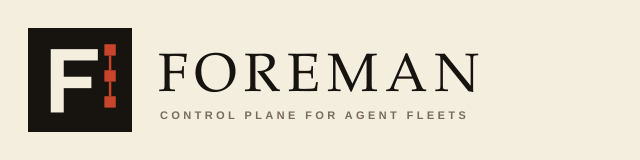
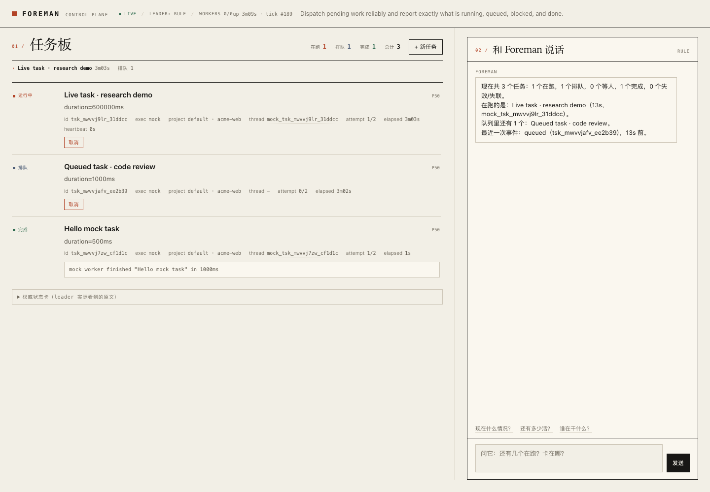

<p align="center">
  
</p>

**An always-on control plane for coding-agent fleets.**

[English](README.md) · [简体中文](README.zh-CN.md)

[](https://github.com/Simon-He95/foreman/actions/workflows/ci.yml)
[](https://www.npmjs.com/package/foreman-ops)
[](LICENSE)
[](package.json)
[](#status)

You talk to one leader. The leader keeps a task ledger, a daemon leases work to
worker threads, and every completion wakes the leader with a state card built
from SQLite — not from model memory.



Foreman is the missing operations layer between you and a coding-agent UI:

- **Durable ledger** — tasks, leases, attempts, events, inbox, chat. Restarting
  the process does not forget what was running.
- **Leases, not guesses** — a silent worker is not a completed worker. Missing
  heartbeats are requeued or failed, not marked done.
- **Push completions** — terminal states land in an inbox and wake the leader;
  you do not have to keep asking "are we there yet?".
- **One answer** — counts and status come from `buildStateCard()`, shared by
  the leader, dashboard, API, and notifications.
- **Proof of work** — optional completion contracts: a token, a non-empty
  artifact, an artifact marker, or a git diff.
- **Native T3 lineage** — a Foreman master thread can delegate child tasks into
  T3's Thread details / Lineage view, instead of scattering top-level threads.

## What it is, and what it is not

Foreman is not another agent runtime. [T3 Code](https://t3.codes) is the
execution layer and worker UI; a T3 ACP provider (DimAgent, Codex, Claude, or a
compatible provider) supplies the model and tools. Foreman supplies the
control plane: queueing, leases, retries, recovery, contracts, and status.

```text
you ── chat + task board ──> Foreman leader (rule | claude | codex | dim)
                                │
                     SQLite: tasks / events / inbox / chat
                                │
                     daemon: claim → lease → poll → retry → reattach
                                │
                     adapter: mock | t3
                                │
                  T3 Code server ──> thread ──> Claude / Codex / Dim / ACP agent
                                └── worktree, diff, approvals, mobile UI
```

T3 can run without Foreman. Foreman can run without T3 in `mock` mode. Together
they give an agent fleet a durable, inspectable memory and a single source of
truth. Design rationale, non-goals, and the module map live in
[DESIGN.md](DESIGN.md).

## Choose a path

| Goal | Needs | First-run time | Start |
| --- | --- | --- | --- |
| See the ledger and dashboard | Node.js >= 22.5 | ~2 min | `npm install -g foreman-ops` then `foreman demo --duration 20` |
| Run a mock control plane | Node.js >= 22.5 | ~3 min | `foreman init --yes --adapter mock` then `foreman up` |
| Run real coding agents | Node.js + T3 Code + an authenticated ACP provider | 10–20 min | [T3 setup](#use-with-t3-code) |
| Chat with Foreman inside T3 | the real path + a registered provider | +5 min | `foreman master create` |

Foreman does **not** bundle T3 Code and does **not** include a model provider.
T3 is the execution layer and worker UI; a provider such as DimAgent, Codex, or
Claude supplies the model and tools. There is no one-click desktop installer
yet. The CLI is published as **`foreman-ops`** on npm:

```bash
npm install -g foreman-ops
```

Source checkout remains available for contributors and the latest unreleased
changes.

| Dependency | Required for | Notes |
| --- | --- | --- |
| Node.js >= 22.5 | everything | uses `node:sqlite` |
| T3 Code 0.1.x | real agents, T3 master | separate app/server; tested with `0.1.11` |
| ACP provider + auth | real agents | DimAgent is the reference path; Codex/Claude work through T3 |
| Git project directory | real agents | native lineage needs the master and task in the same T3 project |
| macOS or Linux | tested platforms | Windows is untested; launchd service is macOS-only |
| Ports `3773` / `3777` | T3 / Foreman dashboard | change them if occupied |

If you do not install T3, you can still run the mock demo and the dashboard.
Mock tasks exercise the queue, leases, retries, notifications, and UI; they do
not edit your code or run a model.

## Quickstart

Requirements: Node.js **>= 22.5**. T3 Code is only needed for real worker
threads; the demo and mock control plane use a local adapter.

### 1. Install the CLI

From npm:

```bash
npm install -g foreman-ops
foreman --help
```

Contributors can run the current `main` from source:

```bash
git clone https://github.com/Simon-He95/foreman.git
cd foreman
npm install
npm test
npm install -g .
```

### 2. Try the mock demo (no model needed)

```bash
foreman demo --duration 20
```

From a source checkout, `npm run demo -- --duration 20` is equivalent.

This starts a control plane, dispatches mock tasks, wakes the leader on
completion, and prints the briefing. The demo is intentionally isolated from
your normal data directory. It does not need T3 or a model, and it does not edit
your project.

### 3. Run the wizard

```bash
foreman init
```

The wizard writes `foreman.config.json` with mode `0600` and configures:

- project directory and allowed roots
- `mock` or `t3` adapter
- leader (`rule`, `dim`, `claude`, or `codex`)
- worker provider/model and fast / strong / coding model tiers
- data directory and dashboard port
- optional T3 provider registration

For scripts and CI:

```bash
foreman init --yes \
  --adapter mock \
  --leader rule \
  --project . \
  --data-dir .foreman \
  --port 3777
```

### 4. Start the control plane

```bash
foreman up
# dashboard: http://127.0.0.1:3777
```

Add work from another terminal:

```bash
foreman add "Fix the flaky login test" \
  --brief "Find the race and add a regression test" \
  --priority 80

foreman status
foreman ask "What is running, what is queued, and what is blocking?"
```

## Use with T3 Code

T3 Code is a **separate dependency**: install/start it yourself, add the project,
and authenticate at least one ACP provider. Foreman can run in front of it and
keep the operational state outside the model context. The provider registration
below requires a T3 restart before the **Foreman (control plane)** provider
appears.

```bash
# 1. Verify, start T3, and add your project
npx t3@latest --version
npx t3@latest serve --no-browser --port 3773
npx t3@latest project add /path/to/your/repo

# 2. Authenticate your ACP provider in T3, then configure + register Foreman
foreman init --adapter t3 --provider dim \
  --project /path/to/your/repo \
  --model dimcode-api-oauth/deepseek-v4.1-flash \
  --leader dim --register

# From a source checkout, npm run t3:register-foreman does the registration.
# For the DimAgent worker, the source-only helper is: npm run t3:register-dim

# 3. Restart T3 so the new provider appears, then start Foreman
foreman up --adapter t3 --leader dim

# 4. Create the T3 master thread that receives notifications
foreman master create --title "Foreman"
```

Then create a T3 thread with provider **Foreman (control plane)** and talk to
it normally. The master thread only reads state and creates/cancels/retries
tasks; work happens in worker threads. You can also skip the master and use the
dashboard/CLI; the master is what adds in-T3 chat and completion notifications.

If you already have a master thread:

```bash
foreman master set mcp:<thread-id>
foreman master show
foreman master test
```

Native lineage requires the master and the task to share the same T3 project.
A master in a different project, or a non-Foreman thread, falls back to a
top-level worker thread. See [Native lineage](docs/native-lineage.md). The Rust
DimAgent alpha can be registered as the `dima` provider; see
[DimAgent Rust](docs/dima.md).

## Daily operation

Normal use needs **two long-running processes**, started in this order:

1. **T3 Code** — desktop app, or `npx t3@latest serve --no-browser --port 3773`.
   Keep it running; worker threads live inside T3.
2. **Foreman** — from your project directory:

   ```bash
   cd /path/to/your/repo
   foreman up
   ```

   `foreman up` is a blocking process. It runs the daemon, leader loop, API, and
   dashboard, so keep that terminal open (or use tmux / `foreman service`).

Then choose one interface:

- **T3 master** — open the bound thread (`foreman master show`) and chat there.
  Create it once with `foreman master create --title "Foreman"`; the provider is
  **Foreman (control plane)**.
- **Dashboard / CLI** — open `http://127.0.0.1:3777` or run
  `foreman add ...` / `foreman status` from another terminal.

The dashboard is optional. If you close the `foreman up` process, queued and
running tasks stop progressing; restarting `foreman up` reattaches by thread id.
If you close T3, its worker threads disappear. For unattended 24/7 operation on
macOS, use `foreman service` and keep T3 running as a service/app as well.

Do not run two `foreman up` processes against the same data directory; the pid
lock will reject the second one.

## Core concepts

One leader reads a durable SQLite ledger; tasks get leases and attempts; terminal
states wake the leader through an inbox; optional contracts add evidence. Native
lineage is the T3 path for a task, not a second runtime. See
[docs/concepts.md](docs/concepts.md) and [DESIGN.md](DESIGN.md).

## Commands

The common commands are `init`, `up`, `add`, `status`, `ask`, and `master`.
Full command/flag reference: [docs/commands.md](docs/commands.md).

## Models and effort

The leader chooses a tier: simple lookup and ordinary work use the fast model,
deep research uses the strong model, and only actual code edits use the coding
model. Override it on any task:

```bash
foreman add "Audit the payment callback" \
  --brief "Focus on concurrency and idempotency" \
  --model dimcode-api-oauth/gpt-6.2-astra \
  --effort max
```

The **leader** has an independent `leaderMode` / `leaderProvider` /
`leaderModel` / `leaderEffort`; worker threads use `t3Provider`, `t3Model`, and
the fast/strong/coding tiers. In the FC, you can also assign provider/models by
task category: “research with X, fixes with Y, default with Z.” Foreman persists
those routes per master (`workerModelRoutes`) and shows the current FC identity
and route table to the leader. Routes are provider-qualified; a one-off request
uses `modelOverride`. The optional `forceModel` / `forceProvider` locks remain
available when a deployment truly needs a fixed fleet. Provider/model identity
and reasoning option ids are resolved from the T3 catalog; a bare model slug
claimed by multiple providers is rejected instead of guessed from its string.

The control plane stores each task's resolved target plan (provider/model,
actual reasoning option/value, source, and catalog revision) and passes it to
workers, so a worker with a different T3 cache cannot silently choose another
model. Typed `modelTiers` can assign a different provider/model to each tier.

When you create a **Foreman (control plane)** thread in T3, its model picker
lists configured FC provider/model choices and its effort picker sets the
leader effort for that thread. `leaderChoices` can add explicit provider/model
choices; otherwise Foreman discovers models from the enabled T3 provider
caches. The choice is persisted per T3 thread and reused on resume; turns are
queued per master, and task notifications return to the master that created
them. Check the effective values and choices with `foreman models` and
`foreman master show`. See
[Models and effort](docs/models-and-effort.md). The dashboard also has a
**Model routing** panel: it shows the current Run's provider/model/effort and
project, validates routes against the T3 catalog snapshot, lets you assign
`default` / `light` / `standard` / `deep` / `coding` targets, and has a
one-click “use current Run for all” action. Invalid targets are surfaced before
a task starts. Restart T3 after adding a provider/model so its cache refreshes.

## Documentation

- [Docs index](docs/README.md)
- [Quickstart](docs/quickstart.md)
- [Concepts](docs/concepts.md)
- [Configuration](docs/configuration.md)
- [Native lineage](docs/native-lineage.md)
- [Models and effort](docs/models-and-effort.md)
- [Workers](docs/workers.md)
- [Security](docs/security.md)
- [Troubleshooting](docs/troubleshooting.md)
- Recipes: [research](docs/recipes/research.md) ·
  [code fix](docs/recipes/code-fix.md) ·
  [review](docs/recipes/review.md) ·
  [current info](docs/recipes/current-info.md)

## Security

Foreman is local-first and privileged: it can start agents that edit code and
use the network.

- Keep `allowedProjectRoots` narrow.
- Do not expose the dashboard without TLS and a bearer token.
- Use per-worker tokens for remote workers; revoke them when done.
- Never commit `foreman.config.json`, tokens, or data directories.
- Treat leader actions as code execution. Review unattended/destructive paths.

See [SECURITY.md](SECURITY.md) and [docs/security.md](docs/security.md).

## Status

Foreman is **1.2**. The ledger, leases, retries, completion contracts, mock
adapter, T3 adapter, dashboard, worker mode, native lineage path, schema
migrations, and macOS CI are implemented and covered by the test suite
(`npm test`). The real T3 + DimAgent path has been exercised end-to-end on the
maintainer's machine.

Known limits and the roadmap are tracked in
[docs/README.md](docs/README.md#status-and-limits) and
[issues](https://github.com/Simon-He95/foreman/issues). Release notes live in
[CHANGELOG.md](CHANGELOG.md). In particular:

- one control plane per SQLite ledger; no HA yet
- worker transport is HTTP; bring your own TLS
- no budget enforcement yet
- T3 completion is polled each tick; MCP events/webhooks are next
- worker model slugs are explicit config; FC choices are discovered from enabled T3 providers (plus `leaderChoices`)
- master notifications are user-role messages in T3, not OS notifications

## Contributing

Issues and pull requests are welcome. Start with [CONTRIBUTING.md](CONTRIBUTING.md)
and run `npm test` before opening a PR.

## License

[MIT](LICENSE) © 2026 Simon He
