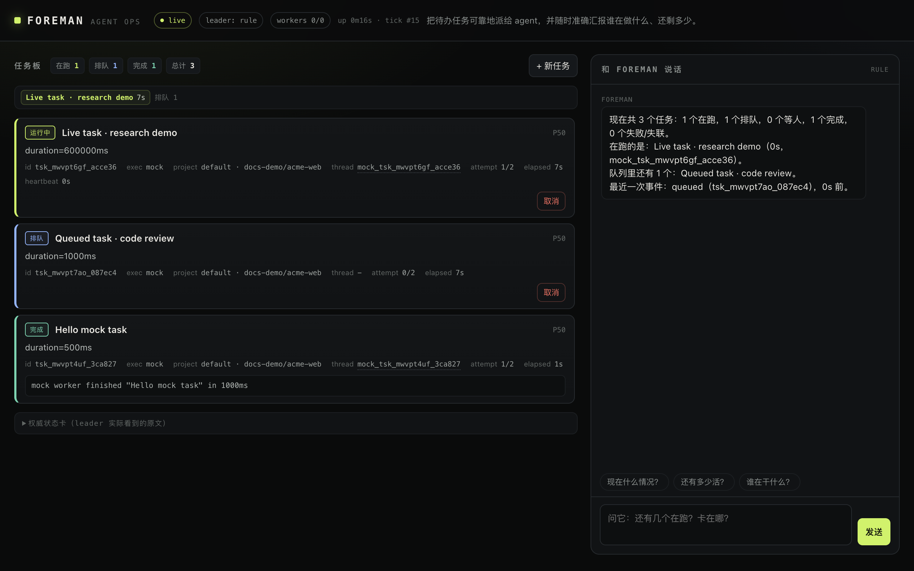

# Foreman

**给编码 Agent 集群用的常驻控制面。**

[English](README.md) · [简体中文](README.zh-CN.md)

[](https://github.com/Simon-He95/foreman/actions/workflows/ci.yml)
[](LICENSE)
[](package.json)

你只和一个 leader 对话。leader 维护任务账本，daemon 把任务租给 worker
线程；每次完成都会唤醒 leader，并附上一张从 SQLite 生成的状态卡，而不是靠
模型记忆。



Foreman 补的是你和编码 Agent UI 之间的运维层：

- **持久账本**：任务、租约、attempt、事件、inbox、对话全部落 SQLite；进程重启不会忘记谁在跑。
- **租约而不是猜测**：worker 静默不等于完成；心跳丢失会重新排队或失败。
- **完成推送**：终态进入 inbox 并唤醒 leader，不用反复问“跑完没有”。
- **唯一答案**：计数和任务摘要统一由 `buildStateCard()` 生成，leader、面板、API、通知共用。
- **完成契约**：可选 token、非空 artifact、内容标记或 git diff，避免“回复了 DONE 但没干活”。
- **T3 原生 Lineage**：Foreman 主控线程可以把子任务委派成 T3 的 child thread，在 Thread details / Lineage 里直接看到。

## 它是什么

Foreman 不是另一个 Agent runtime。[T3 Code](https://t3.codes) 负责执行和
worker UI，T3 ACP provider（DimAgent、Codex、Claude 或兼容实现）提供模型和工具。
Foreman 提供控制面：排队、租约、重试、恢复、完成契约和状态汇总。

```text
你 ── 对话 + 任务板 ──> Foreman leader (rule | claude | codex | dim)
                          │
               SQLite: tasks / events / inbox / chat
                          │
               daemon: claim → lease → poll → retry → reattach
                          │
               adapter: mock | t3
                          │
                T3 Code ──> thread ──> Claude / Codex / Dim / ACP agent
```

T3 可以单独使用；Foreman 也可以在 `mock` 模式下完全不依赖 T3 运行。

## 快速开始

要求 Node.js **>= 22.5**（使用 `node:sqlite`）。真实 worker 需要 T3；demo 不需要模型。

```bash
git clone https://github.com/Simon-He95/foreman.git
cd foreman
npm install
npm test

# 不需要模型的完整演示
npm run demo -- --duration 20
```

安装为本地命令：

```bash
npm install -g .
```

### 初始化

```bash
foreman init
```

向导会以 `0600` 权限写入 `foreman.config.json`，配置项目目录、`mock|t3`
adapter、leader、provider/model、数据目录和端口，并可顺手注册 T3 provider。

非交互模式：

```bash
foreman init --yes \
  --adapter mock --leader rule \
  --project . --data-dir .foreman --port 3777
```

### 启动

```bash
foreman up
# 面板：http://127.0.0.1:3777
```

另开终端加任务：

```bash
foreman add "修掉登录页的 flaky test" \
  --brief "定位竞态并补回归测试" \
  --priority 80

foreman status
foreman ask "现在谁在跑，队列里还有什么，卡在哪？"
```

## 在 T3 里使用

```bash
# 1. 启动 T3 并添加项目
npx t3@latest serve --no-browser --port 3773
npx t3@latest project add .

# 2. 注册 Foreman provider；DimAgent worker 可选
npm run t3:register-foreman
npm run t3:register-dim

# 3. 重启 T3，启动 Foreman
foreman up --adapter t3 --leader dim

# 4. 创建接收任务通知的主控线程
foreman master create --title "Foreman"
```

然后在 T3 新建 thread，provider 选 **Foreman (control plane)**，直接说话。
主控只读状态、建/取消/重试任务；真正干活的是 worker 线程。

已有主控线程时：

```bash
foreman master set mcp:<thread-id>
foreman master show
foreman master test
```

原生 Lineage 要求主控和任务在同一个 T3 项目；跨项目或普通 thread 会回退到
top-level worker。详见 [原生 Lineage](docs/native-lineage.md)。

## 核心概念

| 概念 | 说明 |
| --- | --- |
| Task ledger | 每个任务、attempt、租约、事件、inbox、对话都落 SQLite。 |
| Lease + heartbeat | running 任务必须持续证明存活；静默不是成功。 |
| Completion inbox | 终态批量推给 leader，不靠对话记忆轮询。 |
| State card | 有界的确定性状态卡，所有界面共用。 |
| Completion contract | 可选的 token / artifact / marker / git diff 完成证明。 |
| Project registry | `web`、`api` 等项目名映射到本地路径和 adapter。 |
| Worker mode | 本地/远程 worker 用独立可撤销 token claim 任务。 |
| Native lineage | 主控 → T3 child thread（`parentThreadId` + `subagent`）。 |

## 常用命令

| 命令 | 作用 |
| --- | --- |
| `foreman init` | 初始化向导，写 `foreman.config.json`。 |
| `foreman up` | daemon + leader + 面板。 |
| `foreman add` / `cancel` / `retry` / `resume` | 管理任务。 |
| `foreman status` / `ask` | 状态卡 / 一轮 leader 对话。 |
| `foreman master ...` | 绑定和测试 T3 主控线程。 |
| `foreman project ...` | 管理项目注册表。 |
| `foreman worker ...` | 注册、运行、drain、revoke、安装 worker。 |
| `foreman doctor` | 检查 Node、T3、provider、数据库、端口和认证。 |
| `foreman backup` / `compact` | 在线备份 / 清理历史。 |
| `foreman service` | 生成 macOS launchd 常驻服务。 |

完整命令和 flag 见 [文档索引](docs/README.md) 与
[配置](docs/configuration.md)。

## 模型与 effort

任务可以单独指定模型和思考等级；不指定时 leader 按难度选择 fast /
standard / deep / coding 四档。DimAgent 下默认：

```bash
foreman add "审查支付回调" \
  --brief "重点看并发和幂等" \
  --model dimcode-api-oauth/gpt-6.2-astra \
  --effort max
```

切换 provider 时请显式设置 `modelFast`、`modelStrong`、`modelCoding` 和
`t3ReasoningOption`。详见 [模型与 effort](docs/models-and-effort.md)。

## 文档

- [文档索引](docs/README.md)
- [快速开始](docs/quickstart.md)
- [核心概念](docs/concepts.md)
- [配置](docs/configuration.md)
- [原生 Lineage](docs/native-lineage.md)
- [模型与 effort](docs/models-and-effort.md)
- [Worker](docs/workers.md)
- [安全](docs/security.md)
- [排障](docs/troubleshooting.md)
- Recipes：[调研](docs/recipes/research.md) ·
  [修代码](docs/recipes/code-fix.md) ·
  [审查](docs/recipes/review.md) ·
  [查实时信息](docs/recipes/current-info.md)

## 安全

Foreman 是本地优先、但权限很高的软件：它能启动会改代码、联网的 Agent。

- 尽量收窄 `allowedProjectRoots`。
- 不要把面板裸奔到公网；远程访问必须加 TLS 和 bearer token。
- 远程 worker 使用独立 token，用完 revoke。
- 不要提交 `foreman.config.json`、token 或数据目录。
- leader 的动作等同于执行代码；无人值守和 destructive 路径要单独审查。

见 [SECURITY.md](SECURITY.md) 与 [安全文档](docs/security.md)。

## 状态

Foreman 目前是 **alpha**。账本、租约、重试、完成契约、mock/T3 adapter、
面板、worker 模式和原生 Lineage 均已实现并有测试覆盖；真实 T3 + DimAgent
路径已在维护者机器上端到端验证。

已知限制和路线图见 [docs/README.md](docs/README.md#status-and-limits) 和
[Issues](https://github.com/Simon-He95/foreman/issues)：

- 一个 SQLite 账本只支持一个控制面，暂无 HA
- worker 传输是 HTTP，需要自带 TLS
- 还没有预算/额度限制
- T3 完成状态仍是轮询，后续接 MCP events/webhooks
- 主控通知是 T3 里的 user 消息，不是系统通知

## 参与贡献

欢迎 Issue 和 PR。先读 [CONTRIBUTING.md](CONTRIBUTING.md)，提交前运行
`npm test`。

## License

[MIT](LICENSE) © 2026 Simon He
