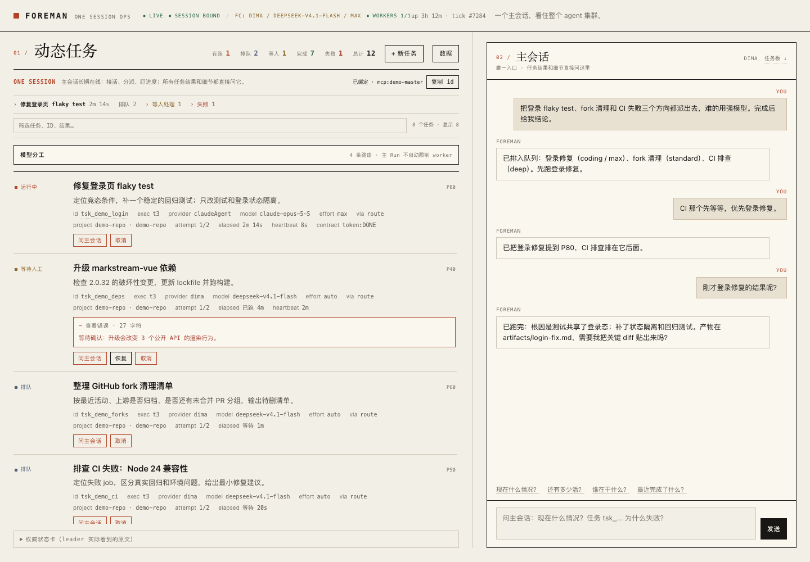

# Foreman docs

Foreman is a **one-session operations layer for T3 Code agent fleets**. The
long-lived master thread is the only interface: it takes new requests, dispatches
worker threads, receives completion/failure notifications, and answers task
details by looking them up in the durable ledger. Users do not need to open each
worker thread.

It is not a general-purpose agent runtime: T3 Code is the UI/thread host, and a
T3 ACP provider (DimAgent, Codex, Claude, or a compatible provider) supplies the
worker model.

It is also not a replacement for T3 native Workflows. T3 owns deterministic
pipelines, schedules, webhooks, and approvals; Foreman owns the dynamic task
queue, routing, status, and retry layer around them.



## Start here

- [Project README](../README.md) — install and the five-minute tour
- [Quickstart](quickstart.md) — choose a path: 2-minute mock demo, persistent
  mock control plane, or real T3 setup in 10–20 minutes
- [Design](../DESIGN.md) — principles, non-goals, runtime topology, module map
- [Concepts](concepts.md) — master, workers, ledger, lineage, effort
- [Commands](commands.md) — CLI, task flags, and model catalog
- [Configuration](configuration.md) — every config key and environment variable
- [Native lineage](native-lineage.md) — parent/child T3 threads
- [Models and effort](models-and-effort.md) — automatic tiers and explicit overrides
- [DimAgent Rust (`dima`)](dima.md) — Rust TUI / ACP harness
- [Workers](workers.md) — local and remote execution
- [Security](security.md) — tokens, loopback, remote access
- [Troubleshooting](troubleshooting.md) — common provider/task failures
- [Maintainers](maintainers.md) — GitHub metadata and release checklist

## Status and limits

Foreman is 1.3. The ledger, leases, retries, completion contracts, mock and
T3 adapters, dashboard, workers, native lineage, resolved target plans,
automatic T3 thread reconciliation, npm update awareness, schema migrations,
and macOS CI are implemented and covered by `npm test`. The supported real path
is T3 Code + a T3 ACP provider; DimAgent is the reference provider.

Known limits:

- one control plane per SQLite ledger; no high availability
- worker transport is HTTP; terminate TLS externally
- no token/cost budget enforcement yet
- T3 completion is polled each tick; MCP events/webhooks are future work
- master notifications are T3 user-role messages, not OS notifications
- one bound master thread; multi-project master routing is on the roadmap
- tier targets are explicit config (`modelTiers` or legacy fields); target
  resolution uses the T3 catalog snapshot
- the T3 catalog is cache-backed, not a live capability/auth RPC; provider auth
  can still fail at thread start and is then blocked as a non-retryable error

## The mental model

```text
T3 master thread (provider=foreman) — the only user-facing session
        │  prompt + task lookup
        ▼
Foreman control plane (/api/ask → leader)
        │  add_task + resolved target plan
        ▼
T3 delegate_task (native child thread) / worker assignment
        │  runs the control-plane-selected target
        ▼
Foreman daemon polls + verifies completion contract
        │
        └── completion notification; task/chat details queried from the same master

deterministic / scheduled / approval pipelines ──> T3 native Workflows
                                  (not reimplemented by Foreman)
```

The dashboard at `http://127.0.0.1:3777` is a secondary ops surface for the
ledger, queue, and maintenance. The T3 master remains the primary one-session
interface.
